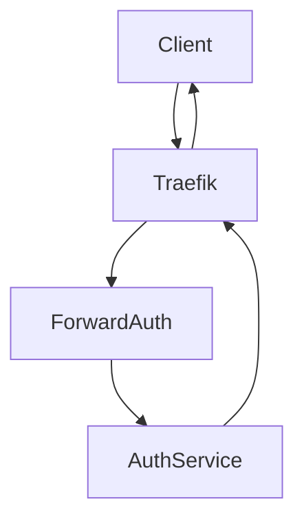

# Traefik Migration for nginx-auth-request

This repository demonstrates migrating a local development setup from **NGINX** using `auth_request` to **Traefik** using the `ForwardAuth` middleware.

The goal is to align the local development environment with the Kubernetes cluster environment where **Traefik is used as the ingress controller** and configuration is managed via **YAML files and IngressRoute resources**.

---

# Overview

The original example uses **NGINX** to authenticate requests through the `auth_request` directive.

```
Client
   ↓
NGINX
   ↓
auth_request
   ↓
Auth Service (/auth)
```

This project replaces the NGINX proxy with **Traefik** while preserving the same authentication behavior using **ForwardAuth middleware**.

```
Client
   ↓
Traefik Router
   ↓
ForwardAuth Middleware
   ↓
Auth Service (/auth)
```

Behavior:

| Auth Result | Outcome                      |
| ----------- | ---------------------------- |
| 200         | Request forwarded to service |
| 401         | Request rejected             |

---

# Architecture



---

# Repository Structure

```
.
├── auth
│   └── auth.py
│
├── traefik
│   ├── traefik.yaml
│   └── dynamic
│       └── routes.yaml
│
├── docker-compose.yml
└── README.md
```

---

# Components

## Auth Service

A simple Flask application that validates requests based on the `x-pretest` header.

Valid token:

```
x-pretest: valid-token
```

Endpoints:

| Endpoint  | Purpose                                 |
| --------- | --------------------------------------- |
| `/auth`   | Authentication endpoint used by Traefik |
| `/health` | Health check endpoint                   |

Example authentication logic:

```
if x-pretest == valid-token
    return 200
else
    return 401
```

---

## Traefik

Traefik acts as the reverse proxy and authentication gateway.

Two configuration layers are used.

### Static Configuration

File:

```
traefik/traefik.yaml
```

Defines:

* entrypoints
* providers
* logging
* dashboard

---

### Dynamic Configuration

File:

```
traefik/dynamic/routes.yaml
```

Defines:

* routers
* services
* middleware

The authentication middleware uses:

```
ForwardAuth
```

Which calls the authentication service before forwarding the request.

---

# Running the Project

Start the services using Docker Compose:

```
docker compose up --build
```

This starts:

| Service | Description                               |
| ------- | ----------------------------------------- |
| auth    | Flask authentication service              |
| traefik | Reverse proxy with ForwardAuth middleware |

---

# Testing the Authentication

## Unauthorized Request

```
curl http://localhost:8080
```

Expected response:

```
401 Unauthorized
```

---

## Authorized Request

```
curl -H "x-pretest: valid-token" http://localhost:8080/health
```

Expected response:

```
Auth service is running
```

---

# Testing with Postman

Create a request:

```
GET http://localhost:8080/health
```

Add header:

```
x-pretest : valid-token
```

Expected response:

```
200 OK
```

---

# Migration Notes

Original NGINX directive:

```
auth_request
```

Traefik equivalent:

```
ForwardAuth
```

This middleware forwards requests to an external authentication service and decides whether to allow or reject access based on the response.

This approach mirrors the behavior used in Traefik-based Kubernetes ingress setups.

---

# Tools Used

* Docker
* Docker Compose
* Traefik v3
* Flask
* Postman / curl for testing

---

# Notes

This repository simulates a **local development environment aligned with a Kubernetes cluster using Traefik ingress resources**.

The migration ensures that local behavior closely matches the production ingress architecture.
